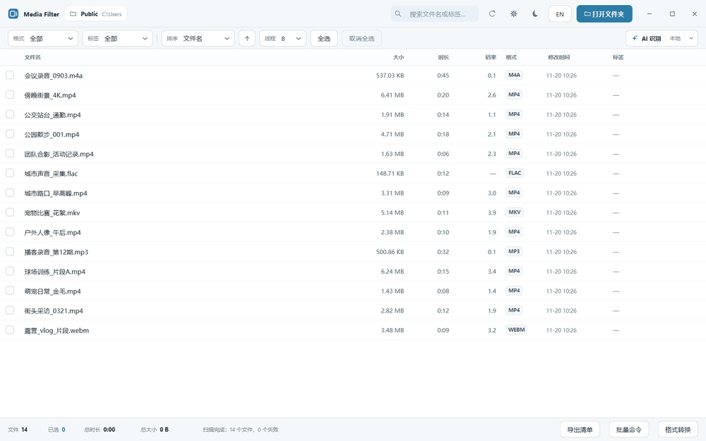
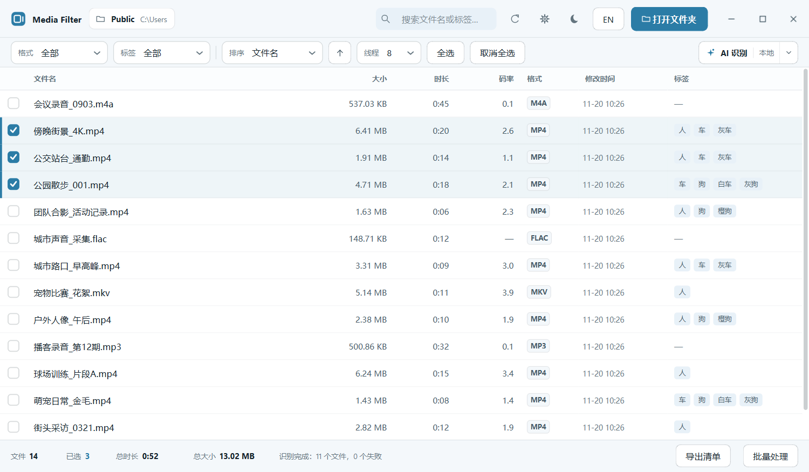
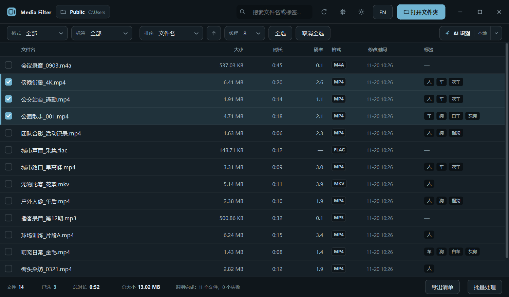
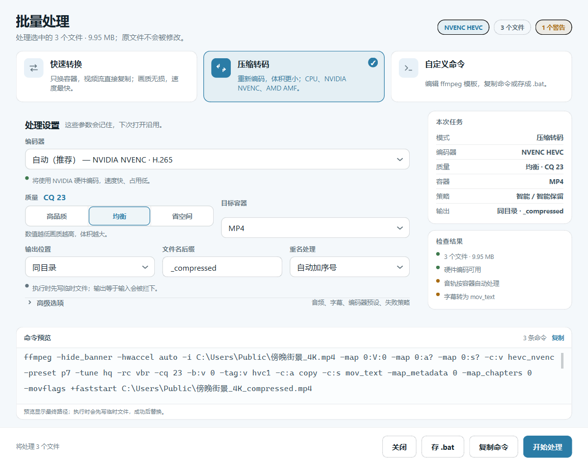
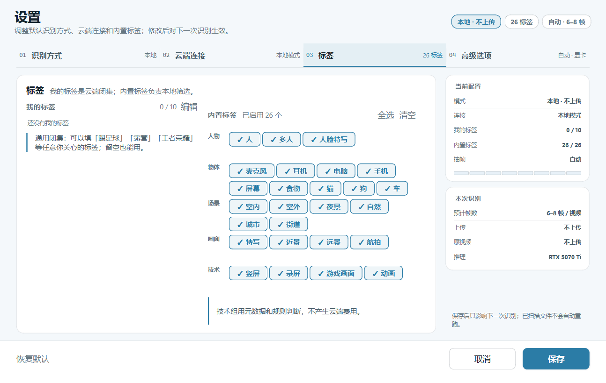

<p align="center">
  
  
  
  
  <a href="https://github.com/yvgui2004/media-filter/actions/workflows/ci.yml"></a>
</p>

<h1 align="center">Media Filter</h1>

<p align="center">
  <b>Find the clip you need by what's in it.</b><br>
  Scan a folder, auto-tag video and audio on your own machine (GPU or CPU), filter by content, and process the selection with FFmpeg — remux, compress, or run your own command.
</p>

<p align="center">
  <b>按画面内容，找到你要的那条素材。</b><br>
  扫描文件夹，本机给每个视频、音频打内容标签（GPU 或 CPU），按标签筛选，再用 FFmpeg 批量处理：转封装、压缩，或跑你自己的命令。
</p>

<p align="center">
  <a href="https://github.com/yvgui2004/media-filter/releases/latest">
    
  </a>
  <a href="#install-from-source--从源码安装">
    
  </a>
</p>

<p align="center">
  
</p>

<p align="center">
  <sub>Real capture: 14 demo files, local YOLOv8n tagging, 11 tagged and 0 failures. / 真实录制：14 个演示文件，本地 YOLOv8n 识别，11 个成功、0 失败。</sub>
</p>

**Why people use it / 为什么用它**

- **Your archive becomes searchable.** Tag clips by people, vehicles, pets, food, screens, scenes and shot size — locally with YOLOv8n (GPU or CPU), or through any OpenAI-compatible vision model. / **素材库变得可搜索**：人物、车辆、宠物、食物、屏幕、场景、景别，本地模型（GPU 或 CPU）或任意 OpenAI 格式视觉模型都能打标。
- **From "find it" to "done" in one window.** Filter by tag, tick what you need, then remux, compress with CPU / NVIDIA NVENC / AMD AMF, or run a custom FFmpeg template — with a command preview, live progress and a result summary. / **从找到到处理只用一个窗口**：按标签筛选，勾选后直接转封装、用 CPU / NVIDIA NVENC / AMD AMF 压缩，或跑自定义 FFmpeg 模板；每一步都有命令预览、实时进度和结果汇总。
- **Labels that speak your workflow.** Add up to 10 of your own labels — `踢足球`, `露营`, `王者荣耀` — and hybrid / cloud tagging will look for them. Local-only mode stays completely offline. / **标签按你的工作流来**：最多添加 10 个自定义标签（踢足球、露营、王者荣耀……），混合 / 全云端识别会专门找它们；纯本地模式仍然完全离线。
- **Nothing leaves your machine unless you say so.** Scanning and local tagging are offline; uploads wait behind a confirmation card, and the API key is DPAPI-encrypted. / **素材默认不出本机**：扫描与本地识别全程离线，上传前必须确认，API Key 用 DPAPI 加密。

> If this saves you time, a ⭐ helps other editors find it. / 如果它帮你省了时间，点个 ⭐ 能让更多剪辑同行看到。

---

## Screenshots / 界面预览

| Light / 浅色 | Dark / 深色 |
| --- | --- |
|  |  |

| Batch processing / 批量处理 | Settings · tags / 设置·标签 |
| --- | --- |
|  |  |

Real screenshots from the running app (main window: local AI tagging on the 14 demo files). / 截图直接来自运行中的程序（主界面为本地 AI 识别 14 个演示文件）。

## Download / 下载 — the fastest way to start / 最快的启用方式

**English** — Grab the latest portable build from **[Releases](https://github.com/yvgui2004/media-filter/releases/latest)**, unzip it, and double-click `MediaFilter.exe`. Python, FFmpeg and the local AI model are all bundled — nothing else to install. You can also run `MediaFilter.exe "D:\footage"` to scan a folder immediately. This is the fastest way to get started; the source build below is only for development or customization.

**中文** — 从 **[Releases](https://github.com/yvgui2004/media-filter/releases/latest)** 下载最新的便携包，解压后双击 `MediaFilter.exe` 即可使用。Python、FFmpeg 和本地 AI 模型都已内置，**不需要安装任何依赖，这是最快的启用方式**；下面的源码方式只用于开发或自行修改。

| Package / 文件 | Contents / 内容 | Requires / 需要 |
| --- | --- | --- |
| `MediaFilter-<version>-win64.zip` | `MediaFilter.exe` (app + YOLOv8n model), `ffmpeg\bin`, `使用说明.txt` | Windows 10 / 11, 64-bit. Nothing else. |

Keep the `ffmpeg` folder next to `MediaFilter.exe`; the app finds it automatically. The single-file exe unpacks itself on launch — about 1–3 s on an SSD (measured 1.7 s on the build machine). / 请保持 `ffmpeg` 文件夹与 exe 的相对位置；单文件程序启动时先自解压，SSD 上约 1–3 秒（打包机实测 1.7 秒）。

## What it does / 它能做什么

**English**

- Recursively scans a folder and reads real metadata with `ffprobe`: size, duration, video and audio bitrate, format, modification time.
- Shows everything in a sortable, filterable table with checkboxes and live totals (file count, total duration, total size).
- **Optional AI tagging** — label videos by what is actually in them: people, screens, food, pets, vehicles, scenery, shot size, technical traits. Local YOLOv8n runs on the GPU through ONNX Runtime DirectML (NVIDIA, AMD and Intel) with a CPU fallback, and recognises 8 of the 26 built-in tags; hybrid keeps the local result and uploads only files where the local pass found something; cloud mode covers all 26. Cats, dogs and cars can also get colour tags (`黑猫`, `白狗`, `白车`). Your own labels sit alongside the built-ins — see [Custom labels](#custom-labels--自定义标签). Results are cached per file.
- **Batch processing** — one dialog with three tasks: fast remux, compression (x265 / x264, NVIDIA NVENC, AMD AMF, auto-detected with a CPU fallback) and custom FFmpeg. It previews the exact command for every file, plans collision-safe output paths, shows live progress and summarises successes, failures and size savings. See [Batch processing](#batch-processing--批量处理).
- TXT report export, light / dark / system themes, Chinese and English UI.

**中文**

- 递归扫描文件夹，用 `ffprobe` 读取真实元数据：大小、时长、音视频码率、格式、修改时间。
- 一张可排序、可筛选的表格，带勾选和实时统计（文件数、总时长、总大小）。
- **可选 AI 内容识别** —— 按画面内容打标签：人物、屏幕、食物、宠物、车辆、场景、景别、技术特征。本地 YOLOv8n 通过 ONNX Runtime DirectML 跑在显卡上（NVIDIA、AMD、Intel，失败自动回退 CPU），可识别 26 个内置标签中的 8 类；混合模式保留本地结果，只把本地已经识别出内容的文件送云端；全云端覆盖 26 个标签。猫、狗、车还会带颜色标签（`黑猫`、`白狗`、`白车`）。内置标签之外还能加你自己的标签，见 [自定义标签](#custom-labels--自定义标签)；结果按文件缓存。
- **批量处理** —— 一个对话框、三种任务：快速转换、压缩转码（x265 / x264、NVIDIA NVENC、AMD AMF，自动检测并支持 CPU 回退）、自定义 FFmpeg。会预览每个文件的实际命令，规划防冲突的输出路径，显示实时进度，结束后汇总成功、失败与体积变化，见 [批量处理](#batch-processing--批量处理)。
- 导出 TXT 清单、浅色 / 深色 / 跟随系统主题、中英文界面。

## Custom labels / 自定义标签

The 26 built-in tags cover the common cases; custom labels cover the rest — a sport, a trip, a game, a client, a recurring shot. Add them in **Settings → 标签 → 我的标签 → 编辑**, or from the **＋ 我的标签** entry on the upload confirmation card.
26 个内置标签覆盖常见内容；剩下的用自定义标签补——某项运动、某次旅行、某个游戏、某个客户、某个固定镜头。入口在 **设置 → 标签 → 我的标签 → 编辑**，上传确认卡上的 **＋ 我的标签** 也能直接改。

- **Up to 10 labels, 20 characters each.** Paste a list separated by English or Chinese commas, `、`, semicolons, tabs or newlines; duplicates are removed case-insensitively (the first spelling wins). Drag the handle to reorder. / **最多 10 个，每个 20 字**。可以整段粘贴，用中英文逗号、`、`、分号、制表符或换行分隔；重复项按大小写不敏感去重（保留第一次的写法）。左侧手柄可拖动排序。
- **Sent to the model exactly as written.** No stemming or merging: `明日方舟` and `明日方舟：终末地` are two independent labels. / **按你写的原样送给模型**，不做合并：`明日方舟` 和 `明日方舟：终末地` 是两个独立标签。
- **Local mode does not use them.** The on-device YOLOv8n is a closed 8-tag set, so custom labels need hybrid or cloud mode. / **纯本地模式用不到它们**：本机 YOLOv8n 是固定的 8 类闭集，自定义标签需要混合或全云端模式。
- **Hybrid mode** runs the local model first and, by default, uploads only files where the local pass found something; the cloud then adds your custom labels and the two sets are merged. Turn off “只上传可能命中「我的标签」的画面” to upload more frames (higher cost). With no custom labels at all, hybrid automatically falls back to local. / **混合模式**先跑本地模型，默认只上传本地已经识别出内容的文件，再由云端补自定义标签并合并结果；关闭「只上传可能命中「我的标签」的画面」会上传更多抽帧、费用更高。一个自定义标签都没有时，混合模式会自动退回纯本地。
- **Cloud mode** uploads every sampled frame and asks for the built-in and custom labels together. / **全云端模式**上传全部抽帧，内置标签和自定义标签一起识别。
- **Results are cached against the label set**, so adding or removing a label re-tags the files instead of serving stale results. / **缓存键包含标签集合**，增删标签会重新识别，而不是返回旧结果。

Example / 示例：

```text
踢足球, 露营, 王者荣耀, 产品开箱
```

## Batch processing / 批量处理

Version 0.2 merged the old **批量命令** and **格式转换** buttons into one **批量处理** dialog. Tick the files, open it, pick a task, check the command preview, then press **开始处理**. Every task uses the same output / progress / summary shell.
0.2 把原来的 **批量命令** 和 **格式转换** 合并成一个 **批量处理** 对话框。勾选文件 → 打开 → 选任务 → 看命令预览 → **开始处理**。三种任务共用同一套输出、进度和结果汇总。

### Tasks / 任务

| Task / 任务 | What it does / 做什么 |
| --- | --- |
| **快速转换 · Fast remux** | Copies the video stream into another container (`mp4`, `mkv`, `mov`, `webm`, `avi`, `flv`, `ts`, `m4v`); audio and subtitles are copied when compatible and converted when not. Lossless and the fastest option. / 视频流直接复制到新容器；音频和字幕能复制就复制，不兼容时自动转换。画质无损，速度最快。 |
| **压缩转码 · Compress** | Re-encodes the video with the chosen encoder and quality tier. / 用选定编码器和画质档位重新编码，体积更小。 |
| **自定义命令 · Custom FFmpeg** | Runs your own template with `{input}` and `{output}`; filters, watermarks, unusual arguments — all yours. / 用 `{input}` / `{output}` 占位符跑自己的模板：滤镜、水印、特殊参数都可以。 |

### Encoders / 编码器

| Family / 平台 | Encoders / 编码器 | Rate control / 码控 | Presets / 预设 |
| --- | --- | --- | --- |
| CPU | x265 (H.265), x264 (H.264) | CRF | medium / slow / faster |
| NVIDIA NVENC | HEVC, H.264, AV1 | CQ (AV1 uses QP) | p7 / p6 / p5 |
| AMD AMF | HEVC, H.264, AV1 | QP | quality / balanced / speed |

Quality tiers are **高品质 / 均衡 / 省空间** (high / balanced / small); the actual CRF, CQ or QP number adapts to the encoder and is shown next to the tier. **Auto** prefers hardware HEVC (NVENC → AMF), then hardware H.264, then AV1, then x265 / x264; if a hardware encode fails, the file is retried on the CPU (the fallback switch is in advanced options). Only encoders that your FFmpeg build lists and your driver supports are offered.
画质档位是 **高品质 / 均衡 / 省空间**，实际的 CRF / CQ / QP 数值随编码器变化并显示在档位旁边。**自动** 的优先顺序是硬件 HEVC（NVENC → AMF）→ 硬件 H.264 → AV1 → x265 / x264；硬件编码失败会对该文件改用 CPU 重试（高级选项里可关）。只有当前 FFmpeg 构建列出、且驱动支持的编码器才会出现。

### Output and safety / 输出与安全

- Output goes to the **same folder** or a **chosen folder**; each task has its own suffix (`_converted`, `_compressed`, `_out`). / 输出可以放**同目录**或**指定文件夹**；每个任务有自己的默认后缀（`_converted`、`_compressed`、`_out`）。
- Name collisions can **add a number**, **skip existing files** or **overwrite with confirmation**. / 重名处理可选 **自动加序号**、**跳过已存在** 或 **覆盖（需确认）**。
- Files are written to a temporary `.part` file and atomically replaced on success. **An input file is never written to**, even in overwrite mode. / 先写临时 `.part` 文件，成功后原子替换；**任何情况下都不会写入源文件**，覆盖模式也一样。
- Advanced options: audio (**smart copy / copy / AAC 128k / Opus 128k / remove**), subtitles (**smart keep / remove**), target container, encoder preset, failure strategy (**continue / stop**), hardware fallback, and keeping chapters and metadata. / 高级选项：音频（**智能复制 / 复制原音轨 / 转 AAC 128k / 转 Opus 128k / 移除**）、字幕（**智能保留 / 移除**）、目标容器、编码器预设、失败策略（**继续下一个 / 停止**）、硬件回退，以及保留章节与元数据。
- Custom mode executes the template **verbatim** — the app does not append audio, subtitle or metadata flags. Preview it and try a small batch first. / 自定义模式**按模板原样执行**，App 不会追加音频、字幕或元数据参数；先预览、先小批量试跑。

### Preview, progress and results / 预览、进度与结果

The dialog shows the exact FFmpeg command for every file and lets you copy it or save all commands as a `.bat`. While running it shows an overall progress bar plus the current file, supports cancel (it stops after the current file), and ends with a summary: succeeded / failed / skipped, total time, size saved, the failure list (copyable) and a button to open the output folder.
对话框会显示每个文件的实际 FFmpeg 命令，可复制，也可把全部命令存成 `.bat`。执行时显示总进度和当前文件，支持取消（当前文件结束后停止）；结束后汇总成功 / 失败 / 跳过、总耗时、体积变化、可复制的失败清单，以及打开输出目录的按钮。

A complete FFmpeg build is required. Hardware encoding needs an FFmpeg build with NVENC / AMF and a current GPU driver; otherwise use CPU or leave the encoder on **Auto**.
需要完整的 FFmpeg。硬件编码要求 FFmpeg 带 NVENC / AMF，并且显卡驱动较新；不满足时选 CPU，或把编码器留在 **自动**。

## Install from source / 从源码安装

**Source only / 仅源码** — this repository stores source only. Prebuilt binaries live in Releases, and the portable zip bundles FFmpeg and the model weights; building from source below does not. Set up the environment once with the steps below.

### Requirements / 环境要求

- Windows 10 / 11, 64-bit. The API key is encrypted with Windows DPAPI; other platforms are untested.
- Python 3.10+ (3.13 tested).
- FFmpeg and `ffprobe`.
- Optional: a YOLOv8n ONNX model for local AI tagging.

**中文**：Windows 10/11 64 位（API Key 用 Windows DPAPI 加密，其他平台未验证）；Python 3.10+（3.13 已验证）；FFmpeg 与 `ffprobe`；本地 AI 识别还需要一个 YOLOv8n ONNX 模型（可选）。

### 1. Get the source / 获取源码

```bash
git clone https://github.com/yvgui2004/media-filter.git
cd media-filter
```

Or download **Code → Download ZIP** on GitHub and extract it. / 也可以在 GitHub 页面点 **Code → Download ZIP** 解压。

### 2. Install FFmpeg / 安装 FFmpeg

The app calls `ffprobe` for metadata and `ffmpeg` for AI frame extraction. It looks in `PATH`, then `C:\ffmpeg\bin`, then `C:\Program Files\ffmpeg\bin`.

```powershell
winget install Gyan.FFmpeg
```

If you prefer a portable copy, put `ffmpeg.exe` and `ffprobe.exe` in `C:\ffmpeg\bin`. Open a **new** terminal and check:

```powershell
ffmpeg -version
ffprobe -version
```

**中文**：程序用 `ffprobe` 读元数据、用 `ffmpeg` 抽帧。查找顺序是 `PATH` → `C:\ffmpeg\bin` → `C:\Program Files\ffmpeg\bin`。用 winget 安装，或把两个 exe 放进 `C:\ffmpeg\bin`。装完重开终端验证；已经打开的程序要重启才会重新查找。

### 3. Create a virtual environment / 创建虚拟环境

```powershell
python -m venv .venv
.venv\Scripts\python.exe -m pip install --upgrade pip
```

Use `py -3.13 -m venv .venv` if you have several Python versions. / 如果装了多个 Python，用 `py -3.13 -m venv .venv` 指定版本。

### 4. Install dependencies / 安装依赖

```powershell
.venv\Scripts\python.exe -m pip install -e ".[ai]"
```

`.[ai]` adds NumPy and ONNX Runtime for local AI. For scanning and cloud tagging only, `pip install -e .` is enough. / `.[ai]` 会装本地 AI 需要的 NumPy 和 ONNX Runtime；只扫描或用云端识别时 `pip install -e .` 就够了。

Mainland China mirror / 国内镜像：

```powershell
.venv\Scripts\python.exe -m pip install -e ".[ai]" -i https://pypi.tuna.tsinghua.edu.cn/simple
```

### 5. Local AI model (optional) / 本地 AI 模型（可选）

Local and hybrid modes need a YOLOv8 detection model. The repository does not include the weights (Ultralytics YOLOv8 is AGPL-3.0). Put a 640×640 ONNX file at `models/yolov8n_fp32.onnx`, or choose another path in **Settings → AI model**.

Export one yourself:

```powershell
.venv\Scripts\python.exe -m pip install ultralytics
.venv\Scripts\python.exe -c "from ultralytics import YOLO; YOLO('yolov8n.pt').export(format='onnx', opset=12)"
move yolov8n.onnx models\yolov8n_fp32.onnx
```

Scanning and cloud-only tagging work without this file. / 纯扫描和全云端识别不需要模型；本地 / 混合模式需要。

### 6. Run / 启动

```powershell
.venv\Scripts\python.exe -m mediafilter
```

Or double-click `run.bat` after step 4. Pass a folder to scan it right away: `.venv\Scripts\python.exe -m mediafilter "D:\footage"`. The first launch opens the setup dialog; settings live in `%LOCALAPPDATA%\media-filter-v2\config.json`. / 装完第 4 步后也可以直接双击 `run.bat`；在命令后面加一个目录可启动后立刻扫描，例如 `.venv\Scripts\python.exe -m mediafilter "D:\footage"`。首次启动会打开设置向导，配置保存在 `%LOCALAPPDATA%\media-filter-v2\config.json`。

### Troubleshooting / 常见问题

- **`ffprobe not found`** — FFmpeg is missing or not on `PATH`. Install it, put it in `C:\ffmpeg\bin`, and restart the app. Without it scanning cannot start.
- **`AI model not found`** — the local ONNX file is missing. Set its path in Settings; scanning and cloud tagging still work.
- **No NVIDIA / AMD encoder in the list** — your FFmpeg build lacks NVENC / AMF, or the GPU driver is missing or too old. Install a full FFmpeg build and update the driver, or use **Auto** / CPU, which always works.
- **Qt platform plugin error** — reinstall PySide6 in the venv (`pip install --force-reinstall PySide6`) and make sure Python is 64-bit.
- **`python` is not recognized** — use the `py` launcher, or reinstall Python with “Add Python to PATH”.
- **Reset settings** — delete `%LOCALAPPDATA%\media-filter-v2\config.json`. This also removes the saved API key and custom labels.
- **Something went wrong** — attach `%LOCALAPPDATA%\media-filter-v2\mediafilter.log` to bug reports. It rotates at 1 MB and keeps 3 backups; keys and frames never reach it.

**中文**：

- **提示找不到 `ffprobe`** —— FFmpeg 没装或不在 `PATH`。装好、放进 `C:\ffmpeg\bin`，然后重启程序；没有它扫描无法开始。
- **提示找不到 AI 模型** —— 本地 ONNX 文件不存在。在设置里指定路径即可；扫描和云端识别不受影响。
- **编码器列表里没有 NVIDIA / AMD** —— 当前 FFmpeg 构建不带 NVENC / AMF，或者显卡驱动缺失 / 太旧。换完整的 FFmpeg 构建并更新驱动；也可以直接用 **自动** 或 CPU，始终可用。
- **Qt platform plugin 报错** —— 在虚拟环境里重装 PySide6，并确认 Python 是 64 位。
- **`python` 不是内部或外部命令** —— 用 `py` 启动器，或重装 Python 时勾选 “Add Python to PATH”。
- **重置设置** —— 删除 `%LOCALAPPDATA%\media-filter-v2\config.json`（会同时清掉 API Key 和自定义标签）。
- **出问题了** —— 反馈问题时附上 `%LOCALAPPDATA%\media-filter-v2\mediafilter.log`。日志按 1 MB 循环、保留 3 份，里面不会出现密钥明文或抽出的画面。

### Build the portable release / 打包便携版（可选）

```powershell
.venv\Scripts\python.exe -m pip install pyinstaller
$env:MEDIAFILTER_FFMPEG_DIR = "C:\ffmpeg\bin"   # a folder with ffmpeg.exe + ffprobe.exe
.venv\Scripts\python.exe packaging\build.py
```

Output: `release\MediaFilter-<version>-win64\` and the matching `.zip`, plus its SHA-256. The exe is onefile; FFmpeg is copied beside it so each launch does not unpack another ~180 MB. Use a **shared** FFmpeg build (exe + DLLs) rather than the static "full" build — the static one adds ~560 MB to the package. / 输出便携目录和同名 zip，附 SHA-256。exe 为单文件，FFmpeg 放在旁边，避免每次启动重复解压。请使用**共享库版** FFmpeg（exe + DLL），静态完整版会让包体多出约 560 MB。

Official releases are built by CI, not by hand: bump the version in `pyproject.toml`, add the matching `CHANGELOG.md` section, then push a tag (`git tag v0.2.1 && git push origin v0.2.1`). The workflow runs tests, downloads the pinned FFmpeg/model (SHA-256 checked), builds the zip, writes release notes and publishes the Release; it also submits a winget PR when the `WINGET_TOKEN` secret is configured. See [packaging/README.md](packaging/README.md). / 正式版本由 CI 构建：改版本号、补 CHANGELOG、推一个 `v*` 标签即可，测试、构建、校验和发布都自动完成；配置了 `WINGET_TOKEN` 时还会自动提 winget PR。

### Tests and type checking / 测试与类型检查

```powershell
.venv\Scripts\python.exe -m pip install -e ".[dev,ai]"
.venv\Scripts\python.exe -m pytest
.venv\Scripts\python.exe -m pyright
```

196 pytest cases run headless (`QT_QPA_PLATFORM=offscreen`), and pyright reports zero errors against `pyrightconfig.json`. Both steps also run on GitHub Actions for every push and pull request. / 共 196 个用例，可在无显示器环境运行；pyright 按仓库内的 `pyrightconfig.json` 检查，0 错误。两步都已接入 GitHub Actions。

## How to use / 如何使用

After installation / 安装完成后：

1. **Scan** — click 「打开文件夹」 and choose a folder. The scan runs in the background and can be cancelled. Filter by format, tag or file name; click any column header to sort.
2. **Tag with AI (optional)** — click **AI 识别**. Local mode stays entirely on your machine; hybrid and cloud modes need an API endpoint and key in Settings. The caret next to the button switches mode. Nothing is uploaded before the confirmation card.
3. **Batch processing** — tick the files and open 「批量处理」. Choose **快速转换** for a lossless container swap, **压缩转码** for x265 / x264 / NVIDIA NVENC / AMD AMF, or **自定义命令** to run an FFmpeg template. Check the preview, then press **开始处理**; commands can be copied or saved as a `.bat`.
4. **Settings** — default recognition mode, GPU / CPU device, API key (stored only on this machine and masked everywhere), model selection, the 26 built-in tags, custom labels (up to 10), colour tags, and sampling / upload options.

Full guide: [使用文档.md](使用文档.md) · Changes: [CHANGELOG.md](CHANGELOG.md) · Contributing: [CONTRIBUTING.md](CONTRIBUTING.md) · Security: [SECURITY.md](SECURITY.md)

**中文**：

1. **扫描** —— 点「打开文件夹」选目录，后台扫描可随时取消；按格式、标签、文件名筛选，点列头排序。
2. **AI 识别（可选）** —— 点 **AI 识别**。本地模式完全在本机推理；混合 / 全云端需要在设置里填接口地址和 Key。按钮右侧箭头切换模式，上传前一定会弹确认卡。
3. **批量处理** —— 勾选文件，打开「批量处理」。**快速转换**只换容器、无损；**压缩转码**可选 x265 / x264 / NVIDIA NVENC / AMD AMF；**自定义命令**跑你自己的 FFmpeg 模板。确认命令预览后点 **开始处理**；命令也可以复制或存成 `.bat`。
4. **设置** —— 默认识别方式、GPU / CPU 设备、API Key（只存本机、界面与日志全部打码）、模型、26 个内置标签、自定义标签（最多 10 个）、颜色标签，以及抽帧和上传选项。

## Tech at a glance / 技术一览

**English**

Python 3.10+ with a PySide6 / Qt6 desktop shell (Fusion plus token-driven QSS themes and a model/view table). Scanning calls `ffprobe` from a cancellable thread pool; FFmpeg work is built as plain data in `core/batch.py` (encoder specs, output planning, collision handling) and executed by `core/batch_exec.py`, kept apart from the UI. AI tagging is an optional extra: frames are piped from `ffmpeg` into ONNX Runtime with a YOLOv8n model, using the DirectML provider on the GPU and falling back to CPU; cloud modes work with any OpenAI-compatible `/v1/models` endpoint. Config is JSON; the API key is encrypted with Windows DPAPI; a rotating log is written next to the config for support. 196 pytest cases and a pyright pass cover the core logic.

**中文**

Python 3.10+，界面为 PySide6 / Qt6（Fusion + token 驱动的 QSS 主题、model/view 表格）。扫描在可取消的线程池里调用 `ffprobe`；FFmpeg 相关逻辑在 `core/batch.py` 里以纯数据构建（编码器规格、输出规划、重名处理），由 `core/batch_exec.py` 执行，和界面解耦。AI 识别是可选依赖：`ffmpeg` 管道抽帧，ONNX Runtime 跑 YOLOv8n，优先用 DirectML 走显卡、失败回退 CPU；抽帧强度在本地和云端共用一套帧数策略。云端模式兼容任意 OpenAI 格式的 `/v1/models` 接口。配置是 JSON，API Key 用 Windows DPAPI 加密，配置旁边写循环日志便于排查问题。196 个 pytest 用例与 pyright 检查覆盖核心逻辑。

## License / 许可

The application source is **MIT** — see [LICENSE](LICENSE).

The repository itself stores source only. The **prebuilt portable release** redistributes three third-party components, each under its own license: an FFmpeg build (**GPL-3.0**), Ultralytics YOLOv8n weights (**AGPL-3.0**) and PySide6 / Qt (**LGPL-3.0**). See [THIRD_PARTY_NOTICES.md](THIRD_PARTY_NOTICES.md) for sources and details. If you redistribute the portable package, comply with those licenses.

**中文**：应用源码采用 **MIT** 许可，见 [LICENSE](LICENSE)。仓库本身只存放源码；**预编译便携包**额外包含三个第三方组件，各自适用其原许可：FFmpeg（**GPL-3.0**）、Ultralytics YOLOv8n 权重（**AGPL-3.0**）、PySide6 / Qt（**LGPL-3.0**）。源码地址与说明见 [THIRD_PARTY_NOTICES.md](THIRD_PARTY_NOTICES.md)；再分发便携包时请遵守对应许可。